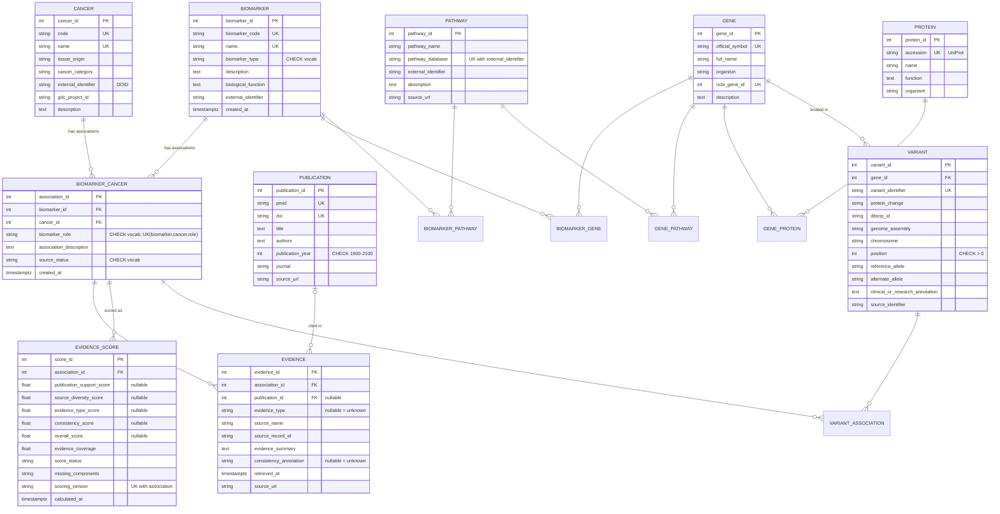

# CancerBioMap

**An Integrated Cancer Biomarker Database with Evidence-Based Association Analysis**

A full-stack biological database (PostgreSQL/SQLite + FastAPI + React) that integrates cancer
biomarkers with genes, proteins, pathways, variants and publications. It computes a transparent
**evidence-support score** and an **evidence-gap analysis** for every biomarker–cancer association.

> **Research and education only.** Scores summarise the evidence *recorded in this database*. They are
> not probabilities of clinical validity and say nothing about clinical approval, safety or effectiveness.

---

## Contents

1. [Abstract](#1-abstract)
2. [Problem statement](#2-problem-statement)
3. [Objectives](#3-objectives)
4. [Literature review guidance and existing systems](#4-literature-review-guidance-and-existing-systems)
5. [Proposed system and novelty claim](#5-proposed-system-and-novelty-claim)
6. [System architecture](#6-system-architecture)
7. [Technology stack and justification](#7-technology-stack-and-justification)
8. [Database design (ER diagram, normalization)](#8-database-design)
9. [Data sources, curation and attribution](#9-data-sources-curation-and-attribution)
10. [Evidence scoring methodology](#10-evidence-scoring-methodology)
11. [Evidence-gap analysis](#11-evidence-gap-analysis)
12. [Installation and execution](#12-installation-and-execution)
13. [API documentation](#13-api-documentation)
14. [Example SQL queries](#14-example-sql-queries)
15. [Testing methodology and results](#15-testing-methodology-and-results)
16. [Project structure](#16-project-structure)
17. [Limitations](#17-limitations)
18. [Future scope](#18-future-scope)

Viva preparation: [docs/VIVA_QUESTIONS.md](docs/VIVA_QUESTIONS.md) · Curation guide: [docs/DATA_CURATION.md](docs/DATA_CURATION.md)

---

## 1. Abstract

Cancer biomarkers are scattered across many resources: gene databases, protein databases, pathway
maps, genomic consortia and the primary literature. Most biomarker lists say *that* a biomarker is
associated with a cancer, but not *how well* that association is supported by the evidence they hold.
CancerBioMap integrates 47 curated biomarkers, 4 cancer types, 43 genes, 40 proteins, 14 KEGG pathways,
12 variants and 84 PubMed publications in a normalized relational schema of 15 tables. For each of the
58 biomarker–cancer–role associations, it computes an explainable evidence-support score from four
components: publication support, source diversity, evidence type and evidence consistency. Unknown
components are treated as *unknown* rather than zero. The system then flags evidence gaps, such as
thin, single-source, untyped, incomplete or conflicting evidence. Every reference identifier in the
sample dataset was verified against the official API of its source (PubMed, NCBI Gene, UniProt, KEGG,
NCI GDC, Ensembl).

## 2. Problem statement

1. Biomarker information is fragmented across heterogeneous resources with different identifiers.
2. Users can see *which* biomarkers are linked to a cancer, but rarely *what evidence* supports each link,
   how diverse it is, or whether it conflicts.
3. Simple counts hide uncertainty. A biomarker with no recorded evidence looks the same as one with
   evidence against it unless missing data is modelled explicitly.
4. Curators need to know where evidence is thin so they can prioritise curation.

## 3. Objectives

- Design a normalized relational schema (3NF) for biomarkers, cancers, genes, proteins, variants,
  pathways, publications, associations, evidence and scores, with full referential integrity.
- Build a validated, idempotent import pipeline for curated CSVs, plus API-based verification
  against public resources.
- Provide REST APIs and a research dashboard for search, filtering, navigation between related
  entities, analytics and CSV export.
- Implement and test an **evidence-aware confidence score** with explicit missing-data handling,
  and an **evidence-gap analysis**.
- Document SQL queries, the methodology and its limitations for academic assessment.

## 4. Literature review guidance and existing systems

Review these established resources (read their documentation and the papers describing them) before
writing your literature review. Verify every claim you make about them from their own documentation.

| Resource | What it provides | Relevance / limitation for this project |
|---|---|---|
| **CIViC** (civicdb.org) | Open, community-curated clinical interpretations of cancer variants, with evidence items, evidence levels and ratings | Rich evidence model. Its evidence levels are expert-assigned; it does not compute a decomposed coverage score with explicit "unknown" components |
| **OncoKB** (oncokb.org) | Expert-curated precision-oncology knowledge base with therapeutic levels of evidence | Authoritative actionability levels; tiers are categorical expert judgements, and some content has licence restrictions |
| **COSMIC** (cancer.sanger.ac.uk/cosmic) | Catalogue of somatic mutations in cancer | Mutation frequencies, not biomarker-role evidence |
| **cBioPortal** (cbioportal.org) | Exploration of cancer genomics datasets (including TCGA) | Data exploration, not curated biomarker–evidence links |
| **MarkerDB** (markerdb.ca) | Database of clinical and pre-clinical molecular biomarkers | Broad biomarker catalogue; evidence-coverage scoring is not its focus |
| **ClinVar** (ncbi.nlm.nih.gov/clinvar) | Variant–condition assertions with review status | Germline/somatic variant interpretation; review "stars" reflect submitter review, not evidence diversity |
| **Cancer Genome Interpreter** (cancergenomeinterpreter.org) | Annotation of tumour alterations, with a catalogue of biomarkers of drug response | Tool-oriented; associations are not scored for evidence coverage |

**Suggested review structure:** (1) biomarker types and roles (diagnostic, prognostic, predictive, risk,
monitoring); (2) biological database design and integration; (3) evidence-level frameworks used by the
resources above; (4) handling of missing and conflicting evidence; (5) the gap this project addresses.

## 5. Proposed system and novelty claim

**Proposed system.** A relational biomarker database that stores each association *per role* (for example,
HER2 / breast / *predictive* is separate from HER2 / breast / *prognostic*). It attaches every piece of
evidence with provenance (source, record ID, retrieval date, URL) and computes a reproducible,
explainable score and gap profile from that evidence.

**Precise novelty claim (keep the wording modest).** CancerBioMap does not claim a new biological finding
or a clinically validated scoring system. Its contribution is an **evidence-coverage assessment that is
decomposable and missing-data-aware**, integrated directly into a teaching-scale relational database:

1. Four normalized, individually inspectable components with configurable weights.
2. Explicit separation of *unknown* from *zero*, with a documented provisional renormalisation and an
   "insufficient" state below a minimum coverage.
3. De-duplication rules: studies are counted by PMID/DOI and sources by name, so duplicate records
   never inflate support.
4. A gap analysis that turns the same evidence metadata into actionable curation flags.

Established resources such as CIViC and OncoKB assign expert evidence levels. This project
complements rather than replaces such approaches. Before claiming novelty in your report, compare it
against the resources in section 4 and state the differences you have verified.

## 6. System architecture

```mermaid
flowchart LR
    subgraph Sources[Public sources]
      PM[PubMed E-utilities]
      NG[NCBI Gene]
      UP[UniProt REST]
      KG[KEGG REST]
      GDC[NCI GDC API]
      EN[Ensembl REST]
    end
    CSV[(Curated CSVs<br/>data/sample)]
    Sources -- verify & enrich<br/>scripts/fetch_pubmed.py<br/>scripts/verify_sources.py --> CSV
    CSV -- validated import<br/>services/importer.py --> DB[(PostgreSQL / SQLite<br/>15 tables)]
    DB --> SVC[FastAPI services<br/>queries · scoring · gaps · analytics]
    SVC --> API[REST API + Swagger /docs]
    API -- /api proxy --> UI[React + TypeScript dashboard<br/>Recharts · React Router]
```



Layers:
- **Data layer**: SQLAlchemy ORM models ([backend/app/models.py](backend/app/models.py)) and Alembic migrations ([backend/alembic/versions](backend/alembic/versions)).
- **Service layer**: query services, the pure scoring function, gap analysis and the SQL report catalogue ([backend/app/services](backend/app/services), [backend/app/scoring.py](backend/app/scoring.py)).
- **API layer**: FastAPI routers with validated parameters and structured errors ([backend/app/routers](backend/app/routers)).
- **Presentation layer**: React single-page app ([frontend/src](frontend/src)).

## 7. Technology stack and justification

| Layer | Technology | Why |
|---|---|---|
| Database | **PostgreSQL** (target), **SQLite** (development fallback) | Mature relational DBMS with CHECK/UNIQUE/FK constraints. SQLite lets the project run with zero setup; the schema and SQL are portable |
| ORM / migrations | SQLAlchemy 2, Alembic | Typed mappings, parameterized queries (no SQL injection), versioned schema changes |
| API | FastAPI + Pydantic v2 | Automatic OpenAPI/Swagger docs and declarative validation |
| Data processing | Python, pandas | CSV parsing and validation, data checks |
| Frontend | React 18, TypeScript, Vite, Tailwind CSS 4 | Typed components, fast builds, consistent styling |
| Charts / icons / routing | Recharts, Lucide React, React Router 6 | Declarative charts, accessible icons, deep-linkable pages |
| Testing | Pytest, FastAPI TestClient, Vitest, Testing Library | Backend unit/integration tests and frontend component tests |

## 8. Database design

### ER diagram



Junction tables (`biomarker_gene`, `biomarker_pathway`, `gene_pathway`, `gene_protein`,
`variant_association`) use **composite primary keys**. The full DDL is in
[backend/sql/schema_postgresql.sql](backend/sql/schema_postgresql.sql), generated from the Alembic migration.

### Design decisions and normalization

- **1NF**: atomic attributes. Multi-valued facts (a biomarker's genes, a gene's pathways) live in junction
  tables, never in comma-separated columns. (CSV files use `;` lists only as an import convenience; the
  importer splits them into rows.)
- **2NF**: every non-key attribute depends on the whole key. Junction tables hold only their keys, plus
  `annotation_source`, which describes that specific link.
- **3NF**: no transitive dependencies. For example, publication metadata is stored once in `publication`
  and referenced by `evidence.publication_id`, not repeated per evidence row; gene facts are not copied
  into `variant`.
- **Association per role**: `UNIQUE(biomarker_id, cancer_id, biomarker_role)`. Evidence for a predictive
  claim differs from evidence for a prognostic one, so each gets its own row, evidence and score.
- **Gene-level pathway membership** (`gene_pathway`) is stored separately from the derived
  `biomarker_pathway` link, which records which gene caused the link (`annotation_source`).
- **Missing data**: nullable `evidence_type`, `consistency_annotation` and score components mean
  *unknown*. CHECK constraints allow NULL explicitly.
- **Integrity**: CHECK constraints enforce controlled vocabularies, year ranges, positive positions and
  "pmid OR doi". FKs use `ON DELETE CASCADE` for dependent rows, `RESTRICT` for referenced master data
  (a cancer with associations cannot be deleted), and `SET NULL` for an evidence row's publication.
- **Indexes**: on all FKs, on search/filter columns (`biomarker.name`, `biomarker_type`,
  `publication_year`, `evidence_type`, `overall_score`) and a composite `(cancer_id, biomarker_role)`.
- **Scores are versioned** (`UNIQUE(association_id, scoring_version)`), so a method change never
  silently overwrites earlier results.

## 9. Data sources, curation and attribution

| Source | Used for | How it was used |
|---|---|---|
| [PubMed / NCBI E-utilities](https://www.ncbi.nlm.nih.gov/books/NBK25501/) | Publication metadata | `esummary` retrieved title, authors, journal, year and DOI for all 84 PMIDs |
| [NCBI Gene](https://www.ncbi.nlm.nih.gov/gene/) | Gene IDs and symbols | 43 genes verified via `esummary` |
| [UniProt](https://www.uniprot.org/) | Protein accessions | 40 reviewed human entries verified via REST |
| [KEGG](https://www.kegg.jp/) | Pathway membership | `/link/hsa/<pathway>` (free for academic use; see KEGG licence) |
| [NCI GDC](https://gdc.cancer.gov/) | TCGA projects | 4 project IDs verified via the GDC API |
| [Ensembl REST](https://rest.ensembl.org/) | Variant coordinates | 8 dbSNP IDs verified (GRCh38 position and alleles) |
| [Disease Ontology](https://disease-ontology.org/) | Cancer identifiers | DOIDs for the 4 cancers |

**Integrity rules followed.** No PMIDs or citations were invented. The curator's initial PMID list was
checked against PubMed, and **11 discrepancies were found and corrected** (wrong PMIDs or title variants)
before import. The PubMed record is the source of truth for metadata. Evidence summaries paraphrase each
paper's main reported finding. Consistency annotations are curator judgements: `supports`, `mixed`,
`conflicting`, or left blank (unknown). The two real documented disagreements included are ASCO
guidance against CEA for colorectal-cancer screening, and the PLCO vs ERSPC PSA-screening trials. KEGG
rows are labelled as database annotations without an evidence type, because gene membership in a disease
map does not support a specific biomarker role. One association (CA 15-3 / breast / monitoring) is
deliberately recorded as `pending_curation` with no evidence, to demonstrate the "insufficient" state.
**No synthetic records are in the sample dataset.**

Re-run the verification yourself (internet required):

```bash
cd backend
python -m scripts.fetch_pubmed            # compare publications.csv with PubMed
python -m scripts.verify_sources          # genes, proteins, variants, KEGG membership
```

## 10. Evidence scoring methodology

```
Score = 0.35·P + 0.25·D + 0.25·T + 0.15·C        (each component 0–100)
```

| Component | Definition (n = distinct count) | Examples |
|---|---|---|
| **P** Publication support | `100·log2(1+n)/log2(1+cap)`, cap = 5, maximum 100 (diminishing returns) | n=1 → 38.7, 2 → 61.3, 3 → 77.4, ≥5 → 100 |
| **D** Source diversity | `100·(1−0.5ⁿ)` over distinct source names | 1 → 50, 2 → 75, 3 → 87.5 |
| **T** Evidence type | `0.7·max + 0.3·mean` of rubric values for the distinct labelled types | RCT + cohort → 92.75 |
| **C** Consistency | `100·(supports + 0.5·mixed)/annotated` | 1 supports + 1 conflicting → 50 |

Evidence-type rubric: meta-analysis 100, randomized clinical trial 95, clinical guideline 90, clinical
trial 85, patient cohort 80, genomic profiling 65, experimental 55, review 40, computational prediction 20.

**Weights and rubric values are proposed project parameters, not validated clinical standards.** Weights
are configurable in `backend/.env` (`SCORE_WEIGHT_*`; they must sum to 1, and startup fails otherwise).

**Missing data.** A component with no observable input is `NULL` (unknown), never 0:
- all four observed → **complete**: weighted sum;
- observed weight ≥ 50% → **provisional**: `Σ(wᵢxᵢ)/Σwᵢ` over the observed components. The UI shows an
  asterisk, a dashed outline, a warning and the missing components;
- otherwise → **insufficient**: no overall score.

**Determinism.** `app/scoring.compute_score` is a pure function (no clock, randomness or database
access). Results are stored with `scoring_version = 1.0.0`.

**Worked example (unit-tested).** Three publications (RCT, cohort, genomic profiling), two sources, two
"supports" annotations → P = 77.37, D = 75, T = 90.5, C = 100 → **83.45**.

Current dataset: 55 complete, 2 provisional (PTEN loss, CDK12: consistency unknown), 1 insufficient (CA 15-3).

## 11. Evidence-gap analysis

Each association is checked for: `no_evidence`, `few_publications` (< threshold, default 2),
`single_source`, `untyped_evidence`, `no_consistency_annotation`, `incomplete_metadata` (missing record
ID, URL, retrieval date, or publication year/journal), `inconsistent` (curated mixed or conflicting
evidence) and `low_score` (< 50 or not computable). The page supports filtering by flag, cancer and role;
sorting; and CSV export. Gaps describe this database's records only: absence here is not absence in the
literature.

## 12. Installation and execution

**Prerequisites:** Python 3.11+ (tested on 3.13), Node.js 18+ (tested on 24). PostgreSQL 14+ is optional.

### Backend

```bash
cd backend
python -m venv .venv
# Windows: .venv\Scripts\activate      macOS/Linux: source .venv/bin/activate
pip install -r requirements.txt
cp .env.example .env                  # SQLite by default
python -m scripts.init_db             # migrate + import sample data + compute scores
uvicorn app.main:app --reload --port 8000
```

API: <http://127.0.0.1:8000/api> · Swagger UI: <http://127.0.0.1:8000/docs> · ReDoc: <http://127.0.0.1:8000/redoc>

### Frontend

```bash
cd frontend
npm install
npm run dev                           # http://localhost:5173 (proxies /api to port 8000)
```

### Using PostgreSQL

```sql
CREATE ROLE cancerbiomap LOGIN PASSWORD '<choose-a-password>';
CREATE DATABASE cancerbiomap OWNER cancerbiomap;
```

Set `DATABASE_URL=postgresql+psycopg://cancerbiomap:<password>@localhost:5432/cancerbiomap` in
`backend/.env`, then run `python -m scripts.init_db`. Alternatively, apply
`backend/sql/schema_postgresql.sql` with `psql` and then run the importer.

> Development note: in this build environment PostgreSQL was not installed, so the application and
> tests were run on SQLite. The PostgreSQL DDL was generated from the same migration (Alembic offline
> mode), and all SQL is written to be portable. Run the steps above once on a PostgreSQL server to
> confirm before your demonstration.

### Reset

```bash
python -m scripts.init_db --reset      # SQLite only: recreate the database file
```

## 13. API documentation

Interactive documentation is generated by FastAPI at `/docs`. Main endpoints:

| Method | Path | Purpose |
|---|---|---|
| GET | `/api/dashboard/stats?cancer_id&role&evidence_type` | Dashboard statistics (computed live) |
| GET | `/api/biomarkers?q&cancer_id&biomarker_type&role&sort&order&page&page_size` | Search/filter/sort/paginate |
| GET | `/api/biomarkers/{id}` | Detail: genes, proteins, pathways, variants, associations, evidence, scores |
| GET | `/api/cancers`, `/api/cancers/{id}`, `/api/cancers/compare?a&b` | Cancer list, detail, comparison |
| GET | `/api/genes`, `/api/proteins`, `/api/pathways`, `/api/variants` (+ `/{id}`) | Entity browsing |
| GET | `/api/publications?q&biomarker_id&cancer_id&year_from&year_to&evidence_type` | Research evidence |
| GET | `/api/associations`, `/api/associations/{id}` | Association, evidence, live score explanation, gaps |
| GET | `/api/scores/methodology` · POST `/api/scores/recompute` | Method description; recalculation |
| GET | `/api/gaps?flag&cancer_id&role&min_publications&sort&order` | Evidence-gap analysis |
| GET | `/api/analytics/catalogue`, `/api/analytics/{report}` | SQL query catalogue and execution |
| GET | `/api/network?biomarker_id` or `?cancer_id` | Relationship graph built from DB links |
| GET | `/api/export/{biomarkers,publications,associations,gaps,analytics}` | CSV export with the same filters |
| POST | `/api/import/{entity}?dry_run=true` | Validated CSV upload (max 5 MB) |

Errors use one structure, `{"error": {"code", "message", "details"}}`, with status 400, 404, 422 or 500.
Internal exceptions and SQL are never returned to the client.

## 14. Example SQL queries

All nine reports are in [backend/sql/query_catalogue.sql](backend/sql/query_catalogue.sql) and on the
*SQL Analytics* page. Two examples:

```sql
-- Shared biomarkers between two cancers (set intersection)
SELECT b.biomarker_id, b.name
FROM biomarker b
WHERE b.biomarker_id IN (
    SELECT biomarker_id FROM biomarker_cancer WHERE cancer_id = :cancer_a
    INTERSECT
    SELECT biomarker_id FROM biomarker_cancer WHERE cancer_id = :cancer_b);

-- Associations with limited evidence (LEFT JOIN keeps associations with none)
SELECT bc.association_id, b.name, c.name, bc.biomarker_role,
       COUNT(DISTINCT e.publication_id) AS n_publications
FROM biomarker_cancer bc
JOIN biomarker b ON b.biomarker_id = bc.biomarker_id
JOIN cancer c    ON c.cancer_id = bc.cancer_id
LEFT JOIN evidence e ON e.association_id = bc.association_id
GROUP BY bc.association_id, b.name, c.name, bc.biomarker_role
HAVING COUNT(DISTINCT e.publication_id) < :max_publications;
```

## 15. Testing methodology and results

```bash
cd backend  && python -m pytest -q        # 51 tests
cd frontend && npm test                   # 9 tests
```

| Area | Tests (file) | Manually verified case |
|---|---|---|
| Scoring | `test_scoring.py` (12) | Hand-calculated score of 83.45; provisional renormalisation; insufficient state; duplicates not double-counted; determinism |
| Schema | `test_database.py` (12) | FK violation rejected; duplicate gene/PMID/association rejected; CHECK vocabularies; cascade delete; Cancer→Biomarker→Gene→Protein→Pathway→Publication navigation; Alembic migration produces the model's tables |
| Import | `test_import.py` (10) | Sample counts (47/4/84/58/43); re-import inserts 0; row-numbered errors; atomic rollback; dry run; FK lookups; allele/chromosome validation |
| API | `test_api.py` (17) | EGFR search returns exactly the 2 EGFR biomarkers; breast ∩ colorectal = {HER2}; CA 15-3 flagged with no score; CEA conflict reported; analytics results; CSV export; import endpoint; 404/422 error format |
| Frontend | `src/test/app.test.tsx` (9) | Unknown component rendered as "unknown", not 0; provisional warning; deterministic network layout; query building |

**Results at submission: 51/51 backend and 9/9 frontend tests passing.** The production build
(`npm run build`) also succeeds. The application was run end to end (FastAPI + Vite proxy) and the
main pages were checked in a browser.

## 16. Project structure

```
backend/
  app/            config, database, models (schema), vocab, scoring (pure), main (FastAPI)
    routers/      catalog.py (browse/search), evidence.py (scores, gaps, analytics, import/export)
    services/     queries, scores, gaps, analytics (SQL catalogue), importer
  alembic/        migration environment + versions/0001_initial_schema.py
  data/sample/    curated CSVs (+ kegg_membership.json cache)
  scripts/        init_db.py, fetch_pubmed.py, verify_sources.py
  sql/            schema_postgresql.sql, query_catalogue.sql
  tests/          pytest suite
frontend/
  src/api         typed client + response types
  src/components  layout, UI kit, charts, score breakdown, network graph, evidence list
  src/pages       dashboard, explorers, detail pages, gaps, analytics, methodology, import, about
docs/             VIVA_QUESTIONS.md, DATA_CURATION.md
```

## 17. Limitations

- Small, teaching-scale sample (47 biomarkers, 4 cancers). Landmark positive studies were selected,
  so consistency is skewed towards "supports". The scores reflect curation effort, not the total literature.
- Weights and the rubric are proposed parameters with no empirical calibration. Do not use the score
  for clinical or regulatory decisions.
- Evidence types and consistency annotations are single-curator judgements, with no inter-annotator
  agreement measured.
- Source diversity treats sources by name. Two sources derived from the same study (for example, TCGA
  data and a TCGA paper) are not fully independent.
- Live API retrieval is used for verification/enrichment scripts, not for automatic ingestion of new
  associations.
- Developed and tested on SQLite. PostgreSQL DDL was generated but not executed in this environment.

## 18. Future scope

- Ingest evidence from CIViC (open licence) with record-level provenance, and map evidence levels into
  the rubric.
- Multi-curator annotation with agreement statistics (Cohen's kappa) and an audit log.
- Sensitivity analysis of the weights (rank stability under weight perturbation).
- Authentication and role-based editing; full-text search (PostgreSQL `tsvector`).
- More cancers via GDC project expansion; variant normalisation with HGVS validation.
